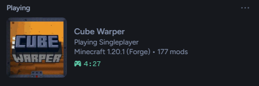

# PrismRPC

Discord Rich Presence for [Prism Launcher](https://prismlauncher.org/), with no mod to install in your modpacks.

PrismRPC shows your Prism instance name, the Minecraft version and loader, your mod count, and whether you're on the main menu, in singleplayer or on a server. It installs once and then works for every instance.



## Features

- **Instance name as the title.** Your profile shows e.g. *Cube Warper* instead of a generic "Minecraft".
- **Live status.** Reads the game log to switch between `Main Menu`, `Playing Singleplayer` and `Playing on <server>`.
- **Play-time timer.** Counts since the game launched, or since you joined a world or server (your choice).
- **Pack icon and "View modpack" button** for modpacks installed through Prism from **Modrinth** or **CurseForge**.
- **Tray icon while playing** with *Pause status*, *Settings* and *Quit*.
- **Settings window** (Start menu → *PrismRPC Settings*). Changes apply to running games straight away.
- **Per-instance on/off.** Hide your status for the instances you don't want to share.
- **Update check.** Tells you when a new release is out.
- **Stays out of the way.** If an instance already has a Rich Presence mod (CraftPresence, Simple RPC, ...), PrismRPC does nothing for that instance.
- **Resilient.** Reconnects if Discord is restarted, and clears your status when the game closes.

## Install

1. Download `PrismRPC-Setup.exe` from the [Releases](../../releases) page.
2. Close Prism Launcher completely.
3. Run `PrismRPC-Setup.exe` once. The settings window opens when it's done.
4. Launch any instance from Prism.

The installer is unsigned, so Windows SmartScreen may warn you the first time. Choose **More info → Run anyway**.

### What the installer does

- Copies the app to `%LOCALAPPDATA%\PrismRPC\app`.
- Sets Prism's global **Pre-launch** and **Post-exit** commands (Settings → Custom Commands), after saving a backup as `prismlauncher.cfg.bak`.
- Adds a Start menu shortcut, *PrismRPC Settings*.
- If you already use your own commands in Prism, it leaves them untouched and tells you instead of overwriting them.

Your settings are stored in `%LOCALAPPDATA%\PrismRPC\settings.json`. PrismRPC adds no startup entry and touches no registry keys. It uses the network only for pack icons (Modrinth, [CFWidget](https://cfwidget.com) for CurseForge) and the GitHub update check, and caches the results.

### Uninstall

Close Prism, then run:

```
"%LOCALAPPDATA%\PrismRPC\app\PrismRPC.exe" --uninstall
```

and delete the `%LOCALAPPDATA%\PrismRPC` folder.

## How it works

When an instance starts, Prism runs PrismRPC as its pre-launch command. It starts a small background process and returns immediately, so game start-up isn't delayed. That process follows the instance's `latest.log` to work out what you're doing and updates Discord. When the game closes, Prism runs PrismRPC with `--stop` and the status is cleared. Each instance is tracked separately, so several can run at once.

## Settings

| Option | What it does |
|---|---|
| Enable PrismRPC | Master switch |
| Tray icon | Show the tray icon while playing (applies next launch) |
| Check for new versions | Daily update check |
| Server address | `Playing on <server>` vs `Playing Multiplayer` |
| Number of mods | Show the mod count |
| "View modpack" button | Shown to other people on your profile (Discord doesn't show you your own buttons) |
| Timer | Since launch / since joining a world / hidden |
| Instances | Untick an instance to hide its status |

Fixed values (Discord application ID, polling intervals, the list of Rich Presence mods to defer to) are in [`config.py`](config.py).

**Forking?** Create your own application in the [Discord Developer Portal](https://discord.com/developers/applications), upload a Rich Presence art asset named `mc_icon` (or change `FALLBACK_IMAGE`), set your own `CLIENT_ID`, and set `GITHUB_REPO` (e.g. `"yourname/yourrepo"`, a full GitHub URL works too) to turn on the update check.

## Build from source

Requires Python 3.8+ on Windows.

```
pip install -r requirements.txt
build.bat
```

This produces `dist\PrismRPC-Setup.exe`. It first builds the app as a folder, then wraps that folder in a one-file installer. The installed app is a folder build on purpose: a one-file exe unpacks itself to a temp folder on every launch, which is slow and can trigger "Failed to remove temporary directory" warnings when Prism runs it for a split second.

For development, `python main.py --settings` opens the settings window, `python main.py --diagnose <instance folder>` prints what PrismRPC sees for an instance, and `python test_prismrpc.py` runs the self-check.

## Is it safe?

PrismRPC is an unsigned program, so Windows SmartScreen warns about it, and a few antivirus engines on [VirusTotal](https://www.virustotal.com) flag it with generic *heuristic* labels (such as `Trojan.Win32.Generic`). That is common for unsigned apps built with PyInstaller. It also does things that look suspicious to heuristics: it edits Prism's config file, starts a background process and creates a Start menu shortcut.

I can't promise a scanner will never flag it, but you don't have to take my word for it:

- **Read the source.** It's all in this repo, and everything it does is described above.
- **Build it yourself** with `build.bat` and compare.
- **VirusTotal scan:** [view the scan](https://www.virustotal.com/gui/file/aab0949fec1c2c17c05ed908c28c74fb22582a8dba7ca0234436c6a52804d8bb/)

## Troubleshooting

- **No status in Discord.** Discord must be running, and *Settings → Activity Privacy → Share your detected activity* must be on.
- **Installer says a command is already set.** You have your own Pre-launch/Post-exit command in Prism. Clear it (Settings → Custom Commands) or chain the commands yourself, then run the installer again.
- **Installer says Prism is running.** Prism rewrites its settings when it exits, which would undo the change. Close it completely, including the tray icon, and retry.
- **No pack icon or button.** Only packs installed through Prism's Modrinth or CurseForge browser have an ID to look up. Hand-made instances show the default icon.
- **Wrong or missing server/singleplayer state.** The state comes from `logs/latest.log`; unusual launch setups or log-changing mods may hide the lines it looks for.

### If a status is missing, ask PrismRPC what it sees

`--diagnose` prints what PrismRPC found for one instance, and what would stop its status. It is read-only: it changes no setting and never touches Prism's config.

```
"%LOCALAPPDATA%\PrismRPC\app\PrismRPC.exe" --diagnose "%APPDATA%\PrismLauncher\instances\Cube Warper"
```

It lists the settings, Prism's Pre-launch/Post-exit commands, the instance's version, loader and mod count, and the status it reads out of `logs/latest.log`, then ends with the things to check: PrismRPC switched off, the instance unticked, a Rich Presence mod installed, a missing launch command, `pypresence` not installed. Add `--json` for a machine-readable report, or `--log FILE` to read a log from somewhere else. `--version` prints the version on its own.

## Platform support

Windows only. The Python source also contains Linux and macOS paths for Prism's config but this has not been tested.

Only **Prism Launcher** is supported. It relies on Prism's pre-launch and post-exit commands, which other launchers (such as the CurseForge app) don't offer.

## About this project

I started PrismRPC as a small script of my own, because I wanted a Discord status for my modpacks without installing a Rich Presence mod in every one. The first version was my own code. Much of the later work, including restructuring it, the installer, the tray icon and the settings window, was done with of help from AI. I run and test it on my own setup, and I'll do my best to maintain it. All the source is here, so you can read exactly what it does.

## Reporting problems and contributing

Found a bug or have an idea? Please [open an issue](../../issues). Say which Prism and Windows version you use, and what happened. Pull requests are welcome too.

## License

[MIT](LICENSE)

## Disclaimer

PrismRPC is an unofficial fan project. It is not affiliated with or endorsed by Mojang, Microsoft, Prism Launcher, Modrinth, CurseForge or Discord. Minecraft is a trademark of Mojang AB. The anvil icon is based on a Minecraft texture.
